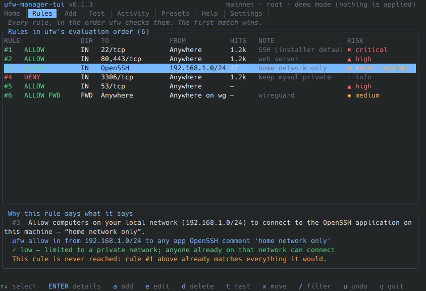
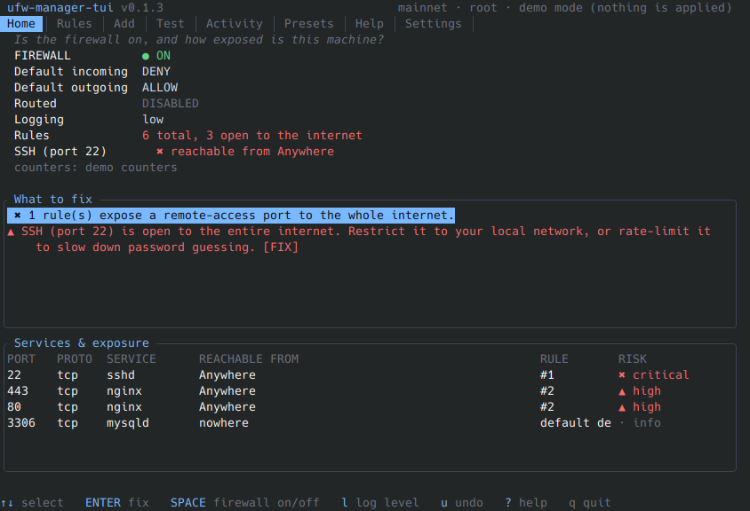
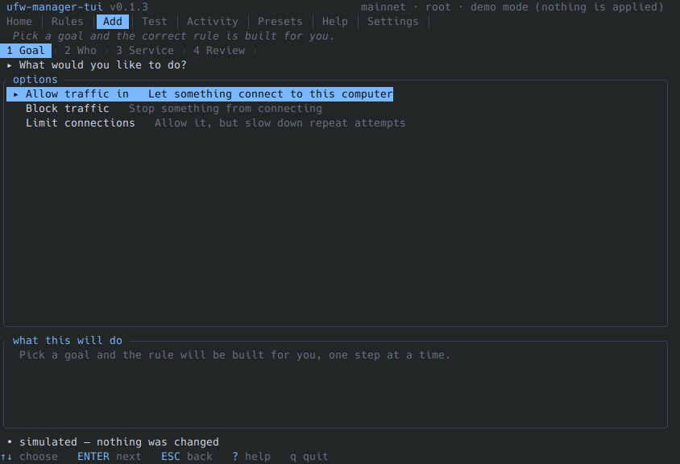
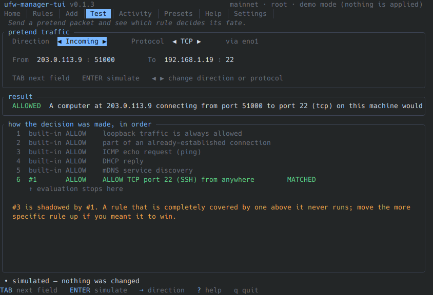
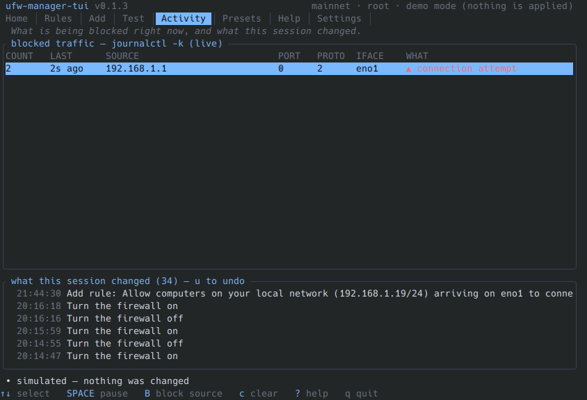
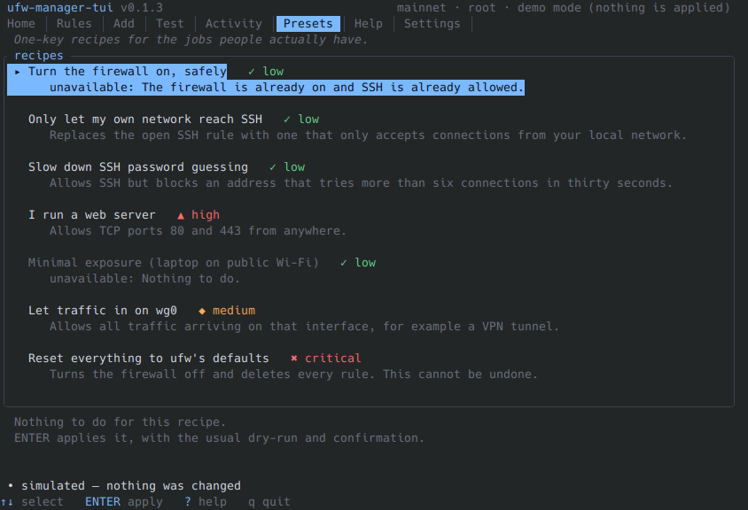
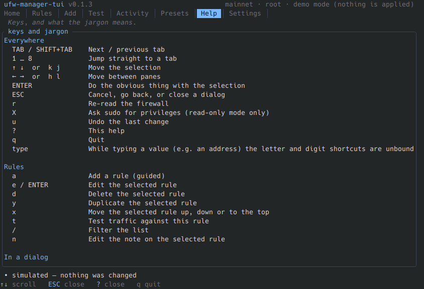

# ufw-manager-tui

A friendly terminal UI for the `ufw` firewall, built for people who are new to Linux and do not want to
lock themselves out of their own machine.



It never invents its own firewall: `ufw` stays the single source of truth. ufw-manager-tui reads it, explains
it, and only ever writes through it.

## Appendix

- [1. Why this exists](#1-why-this-exists)
- [2. Installation](#2-installation)
  - [2.1 Installation from crates.io](#21-installation-from-cratesio)
  - [2.2 Installation from downloaded github repository](#22-installation-from-downloaded-github-repository)
- [3. Try it without touching anything](#3-try-it-without-touching-anything)
- [4. Real world use](#4-real-world-use)
- [5. Key bindings](#5-key-bindings)
- [6. The tabs](#6-the-tabs)
  - [6.1 Home Tab](#61-home-tab)
  - [6.2 Rules Tab](#62-rules-tab)
  - [6.3 Add Tab](#63-add-tab)
  - [6.4 Test Tab](#64-test-tab)
  - [6.5 Activity Tab](#65-activity-tab)
  - [6.6 Presets Tab](#66-presets-tab)
  - [6.7 Help Tab](#67-help-tab)
- [7. Safety model](#7-safety-model)
- [8. Privileges](#8-privileges)
- [9. Options](#9-options)
- [10. Configuration](#10-configuration)
- [11. What it deliberately does not do](#11-what-it-deliberately-does-not-do)
- [12. Honest limitations](#12-honest-limitations)
- [13. Development](#13-development)
- [14. Licence](#14-licence)

## 1. Why this exists

`ufw` is the right tool, but its interface is a syntax. A newcomer is told "enable your firewall", reads
the docs, and is one wrong command away from losing remote access, with no way to check what a rule
actually does before it takes effect.

ufw-manager-tui adds the four things `ufw` cannot give you:

1. **Plain English.** Every rule reads as a sentence next to the exact command that created it.
2. **Preview before apply.** Every change shows the `ufw` command, what it means in words, and the result
   of `ufw --dry-run`, and then waits for one keypress.
3. **A simulator.** Send a pretend packet and see which rule decides its fate, step by step — including
   the common mistake where a broad rule above a narrow one means the narrow rule never runs.
4. **A way back.** Every change goes on an undo stack, and a change that could cut your SSH session
   spawns a detached watchdog that reverts it if you do not confirm you are still connected.

## 2. Installation

Needs Rust 1.85+ and an installed `ufw` (Ubuntu, Debian and derivatives).

### 2.1 Installation from crates.io

```bash
cargo install ufw-manager-tui
```

### 2.2 Installation from downloaded github repository

```sh
git clone https://github.com/ernos/ufw-manager-tui.git
cd ufw-manager-tui
cargo install --path .
```

`sudo ufw-manager-tui` for full control, or `ufw-manager-tui` to browse in read-only mode.

## 3. Try it without touching anything

```sh
ufw-manager-tui --demo
```

## 4. Real world use

There is currently a bug (rendering error) when using the build in key binding `X` to escalate privileges to see and edit firewall rules. Instead use:
```bash
sudo -- ufw-manager-tui
```
or create a link for sudo user
```bash
cd /bin
ln -s /usr/bin/ufw-manager-tui . # Creates a link so that root/sudo can run it
```

Runs against a fake firewall with a realistic rule set. Nothing on the system is read or changed, and it
needs no root — this is also how the UI is screenshot-tested.

## 5. Key bindings

You can do everything with the arrow keys, `Enter` and `Esc`. Letter keys are shortcuts, and the footer
always shows the ones that apply right now.

| Key | What it does |
|---|---|
| `Tab` / `Shift+Tab` | Next / previous tab |
| `1` … `7` | Jump to a tab |
| `↑ ↓` | Move the selection |
| `← →` | Move between panes, or change a field |
| `Enter` | Do the obvious thing with the selection |
| `Esc` | Cancel, go back, close a dialog |
| `r` | Re-read the firewall |
| `u` | Undo the last change |
| `?` | Help and a plain-English glossary |
| `q` | Quit |

On the Rules tab: `a` add, `e` edit, `d` delete, `y` duplicate, `x` move, `t` test, `/` filter, `n` note.

## 6. The tabs

| Tab | What it is for |
|---|---|
| **Home** | Is the firewall on, what is exposed, and what to fix first |
| **Rules** | Every rule in ufw's evaluation order, explained, with hit counts and risk |
| **Add** | A guided wizard: pick a goal, answer two questions, review, apply |
| **Test** | Simulate traffic and see the decision trace |
| **Activity** | Live blocked packets, and what this session changed |
| **Presets** | One-key recipes: lock down SSH, run a web server, minimal laptop, … |
| **Help** | Keys and jargon |

### 6.1 Home Tab



### 6.2 Rules Tab


### 6.3 Add Tab



### 6.4 Test Tab



### 6.5 Activity Tab



### 6.6 Presets Tab



### 6.7 Help Tab



## 7. Safety model

- **`ufw` is the only writer.** The app shells out to it with an argument vector (never a shell string) and
  validates every change with `ufw --dry-run` first. It never edits `/etc/ufw/*` itself.
- **Lockout guard.** Changing the default policy, turning the firewall on, resetting, or deleting the rule
  that currently permits your SSH session are all intercepted before they run.
- **Reconcile watchdog.** After applying a change that flushes the firewall while you are connected over
  SSH, a detached copy of the app reverts it after `reconcile_seconds` unless you press `Y` to confirm you
  are still connected. This is the one feature no other `ufw` front end has.
- **Undo.** Every applied change records its inverse; `u` replays it. Nothing is ever reconstructed by
  rewriting `user.rules`, which is what corrupts rule sets.
- **Notes are real ufw comments** (`ufw allow 22/tcp comment '…'`), not a sidecar file, so they survive
  edits made outside the app and never drift out of sync.

## 8. Privileges

`ufw` only shows and changes rules when it runs as root.

| Situation | Behaviour |
|---|---|
| Started with `sudo` | Everything works |
| Started unprivileged | Read-only: firewall on/off and log level come from the world-readable `/etc/ufw/ufw.conf`; ufw refuses to show the rules to anybody else, and the app says so instead of pretending |
| First write while unprivileged | Leaves raw mode, runs `sudo -v`, and retries — disable with `--no-escalate` |
| `--readonly` | Never writes, even as root |

## 9. Options

```
ufw-manager-tui [OPTIONS]

      --demo              Run against a fake firewall; nothing is read or changed
      --readonly          Never change the firewall
      --no-escalate       Never invoke sudo
  -y, --yes               Skip the confirmation dialog (the dry run still happens)
      --no-color          Use text risk badges instead of colours
      --ascii             Force ASCII box drawing
      --theme <THEME>     dark, light, 16color or mono
      --config <PATH>     Path to config.toml
      --dump-state        Print the parsed firewall state and exit
```

## 10. Configuration

`~/.config/ufw-manager-tui/config.toml`, all optional:

```toml
theme = "dark"                # dark | light | 16color | mono
confirm_before_apply = true
show_counters = true
counters_refresh_secs = 5
reconcile_seconds = 60        # 0 disables the auto-revert watchdog
ascii_fallback = false
readonly = false
```

The undo journal lives in `~/.local/state/ufw-manager-tui/journal.json`.

## 11. What it deliberately does not do

- Raw `iptables` / `nftables` editing — the wrong abstraction for the audience.
- NAT, port forwarding, VPN or route configuration. Forward (`FWD`) rules are shown, and read-only.
- Container-managed rules: Docker writes its own `iptables` chains that bypass `ufw`. Those are invisible
  here, as they are to `ufw` itself.
- A daemon, a web UI, or multi-host management.

## 12. Honest limitations

- **Hit counters** are read from `nft` and mapped to rule numbers by position inside `ufw-user-input`. A
  `limit` rule expands into several kernel rules, so when the counts do not line up exactly the column shows
  `—` rather than a guessed number. Wrong numbers would be worse than none.
- **The simulator is a model**, not the kernel. It reproduces ufw's built-in rules for loopback,
  established connections, invalid packets, ICMP echo, DHCP and mDNS, and then applies your rules in order.
  It is labelled as simulated for that reason.
- **`ufw status` output is text.** It is parsed defensively (see `src/core/parse.rs` for the exact format
  derivation) and any row that cannot be understood is shown verbatim and left read-only, never dropped —
  rule numbering stays consistent.
- If the process is killed with `SIGKILL`, the terminal may be left in raw mode. `reset` fixes it.

## 13. Development

```sh
cargo test                                    # unit + integration, no root needed
cargo clippy --all-targets -- -D warnings
cargo run -- --demo
```

Layers:

- `src/core/` — pure logic: parsing, command building, the simulator, risk, presets, undo, lockout. No I/O,
  no terminal, and the bulk of the tests.
- `src/backend/` — everything that spawns a process or reads a system file, behind a `Backend` trait with a
  real `ufw` implementation and a mock one.
- `src/ui/` — rendering only. `src/app.rs` holds the state machine and key handling.

See [docs/SPEC.md](docs/SPEC.md) for the full product specification, [docs/TESTING.md](docs/TESTING.md) for
the manual verification checklist, and [docs/GLOSSARY.md](docs/GLOSSARY.md) for the plain-English terms.

## 14. Licence

MIT.
